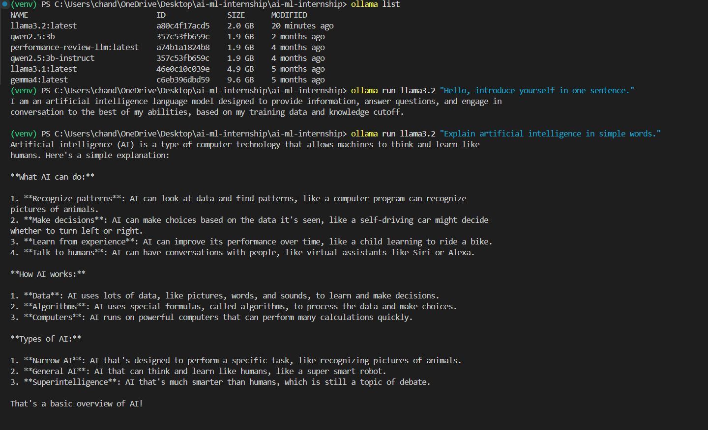

# AI Capstone: Local AI Assistant with Ollama

## Week 1 – Day 1 and Day 2

### Project Objective
Build a local AI assistant using Ollama and an open-source language model such as Llama 3.2 or Mistral. The planned assistant will support custom system prompts, memory, tool calling, and CIA integration for career guidance.

## Current Project Structure

```text
ai-ml-internship/
│
├── .dist/           # Currently empty project directory
├── .git/            # Git version-control information
├── venv/            # Python virtual environment
├── .gitignore       # Specifies files Git should ignore
├── day1-proof.png   # Screenshot of Llama 3.2 execution
└── README.md        # Project documentation
```

## Main Entry Point

Currently, no Python application entry point has been created.

Planned entry point: `main.py` (to be created during implementation).

## Key Python Modules

The project currently has no Python source modules.

Planned modules:

1. `main.py` – Main application entry point.
2. `ollama_client.py` – Handles communication with the local Ollama model.
3. `memory.py` – Manages conversation history and assistant memory.

These are planned modules, not implemented files.

## Configuration and Environment Variables

No `.env`, `config.py`, `settings.py`, or `requirements.txt` file currently exists.

Configuration management will be added during implementation.

## Development Environment

- Operating System: Windows
- Programming Language: Python
- AI Runtime: Ollama
- Model: Llama 3.2
- Version Control: Git and GitHub

## Day 1 – Completed

- Created the project workspace.
- Cloned the GitHub repository.
- Created and activated a Python virtual environment.
- Verified Ollama installation.
- Ran Llama 3.2 locally.

### Execution Command

```bash
ollama run llama3.2 "Hello, introduce yourself in one sentence."
```

### Screenshot



## Day 2 – Project Structure Analysis

- Identified top-level directories and files.
- Inspected the project directory.
- Checked for Python source files.
- Checked for configuration files.
- Documented the existing and planned project structure.

## Upcoming Development

- Create the main application.
- Integrate Ollama with Python.
- Implement custom system prompts.
- Add conversation memory.
- Implement tool calling.
- Integrate CIA for career guidance.
