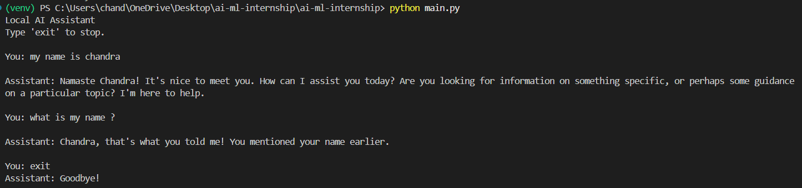
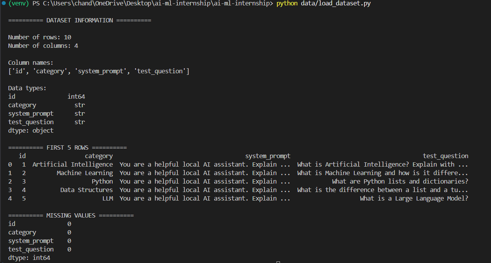

# AI Capstone: Local AI Assistant with Ollama

## Project Objective

Build a local AI assistant using Ollama and an open-source language model such as Llama 3.2 or Mistral. The assistant will support custom system prompts, conversation memory, tool calling, and CIA integration for career guidance.

---

# Week 1 – Day 1: Environment Setup and Ollama Execution

## Tasks Completed

- Created the project workspace.
- Cloned the GitHub repository.
- Created and activated a Python virtual environment.
- Verified Ollama installation.
- Downloaded and configured the Llama 3.2 model.
- Successfully executed Llama 3.2 locally.

## Development Environment

- Operating System: Windows
- Programming Language: Python
- AI Runtime: Ollama
- Model: Llama 3.2
- Version Control: Git and GitHub
- Code Editor: Visual Studio Code

## Execution Command

```bash
ollama run llama3.2 "Hello, introduce yourself in one sentence."
```

## Day 1 Execution Proof


---

# Week 1 – Day 2: Project Structure and Modular Development

## Tasks Completed

- Identified the project's top-level directories and files.
- Created a modular Python application structure.
- Created the main application entry point.
- Implemented the assistant agent.
- Integrated Python with the local Ollama API.
- Implemented basic conversation memory.
- Configured the model name, API URL, and system prompt.
- Successfully executed the local AI assistant.

## Project Folder Structure

```text
ai-ml-internship/
│
├── agents/
│   └── assistant_agent.py       # Controls assistant logic
│
├── config/
│   └── settings.py              # Model configuration and system prompt
│
├── memory/
│   └── conversation_memory.py   # Stores conversation history
│
├── tools/
│   └── ollama_client.py         # Communicates with Ollama API
│
├── data/                        # Stores project datasets and data
│
├── main.py                      # Main application entry point
├── .env.example                 # Example environment variables
├── requirements.txt             # Python dependency information
├── .gitignore                   # Git exclusion rules
├── day1-proof.png               # Day 1 execution screenshot
├── day2-proof.png               # Day 2 execution screenshot
└── README.md                    # Project documentation
```

## Main Entry Point

**`main.py`**

Starts the local AI assistant, accepts user questions, and displays responses generated by Ollama.

## Three Key Python Modules

1. **`agents/assistant_agent.py`** – Coordinates assistant operations and connects conversation memory with the Ollama client.
2. **`tools/ollama_client.py`** – Sends messages to the local Ollama API and retrieves model responses.
3. **`memory/conversation_memory.py`** – Stores user and assistant messages to maintain conversation context during a session.

## Configuration and Environment Variables

- `config/settings.py` – Defines the Ollama model name, API URL, and system prompt.
- `.env.example` – Provides example environment variables.
- `requirements.txt` – Documents Python dependencies.

## Run the Application

Activate the virtual environment:

```powershell
.\venv\Scripts\Activate.ps1
```

Run the application:

```powershell
python main.py
```

## Day 2 Execution Proof

The local AI assistant was successfully executed using the Llama 3.2 model through Python and Ollama.



---

# Upcoming Development

- Improve conversation memory.
- Implement tool calling.
- Add persistent memory across sessions.
- Integrate CIA for career guidance.
- Improve error handling and response quality.
- Perform final testing and documentation.

---

# Project Progress

| Milestone | Status |
|---|---|
| Week 1 – Day 1: Environment Setup | Completed |
| Week 1 – Day 2: Modular Application Setup | Completed |
| Custom System Prompt | Basic implementation completed |
| Conversation Memory | Basic in-session memory implemented |
| Tool Calling | Pending |
| CIA Integration | Pending |
| Final Testing and Documentation | Pending |

# Week 1 – Day 3: Data Flow and Data Structures

## 1. Objective

Understand how data enters the AI assistant, how it is processed, and how the local Large Language Model (LLM) generates the final response.

## 2. Input Data

The project accepts user questions through the terminal.

**Input Example:**

```text
You: What is Artificial Intelligence?
```

**Input Source:** `main.py`

- Uses Python's `input()` function to accept user questions.
- Passes the entered question to the `AssistantAgent`.

## 3. Data Processing

The input passes through the following Python modules:

| Module | Responsibility |
|---|---|
| `main.py` | Accepts user input and displays the response. |
| `agents/assistant_agent.py` | Coordinates assistant operations and manages conversation flow. |
| `memory/conversation_memory.py` | Stores conversation messages using a list of dictionaries. |
| `config/settings.py` | Defines the model name, Ollama API URL, and system prompt. |
| `tools/ollama_client.py` | Converts conversation messages into a JSON request and communicates with Ollama. |

### Processing Steps

1. Receive the user's question.
2. Add the question to conversation memory.
3. Retrieve the system prompt and previous conversation messages.
4. Send the complete message history to the Ollama API.
5. Receive the generated response.
6. Store the assistant's response in conversation memory.
7. Display the response in the terminal.

## 4. Data Structures Used

The project uses a **Python List of Dictionaries** to maintain conversational context.

**Example:**

```python
messages = [
    {
        "role": "system",
        "content": "You are a helpful local AI assistant."
    },
    {
        "role": "user",
        "content": "What is AI?"
    },
    {
        "role": "assistant",
        "content": "AI stands for Artificial Intelligence..."
    }
]
```

### Data Structure Explanation

| Data Structure | Purpose |
|---|---|
| List | Maintains the sequence of conversation messages. |
| Dictionary | Stores each message's role and content. |
| Conversation History | Provides previous messages as context for new questions. |

## 5. Output Data

The local Llama 3.2 model generates a text response through Ollama.

**Output Example:**

```text
Assistant: AI, or Artificial Intelligence, refers to
the simulation of human intelligence in machines.
```

### Output Processing

- The response is received from the Ollama API.
- The response is added to conversation memory.
- The generated text is displayed to the user through the terminal.

## 6. ASCII Data Flow Diagram

The following diagram represents the complete data flow of the local AI assistant.

```text
                USER
                  |
                  v
           Enter Question
                  |
                  v
               main.py
                  |
                  v
        AssistantAgent.chat()
                  |
                  v
         Conversation Memory
        (List of Dictionaries)
                  |
                  v
       System Prompt + Previous
       Messages + Current Input
                  |
                  v
          ollama_client.py
                  |
                  v
             JSON Request
                  |
                  v
          Local Ollama API
          (localhost:11434)
                  |
                  v
            Llama 3.2 Model
           (Local LLM Inference)
                  |
                  v
          Generated Response
                  |
                  v
        Update Conversation Memory
                  |
                  v
               main.py
                  |
                  v
            Display Response
                  |
                  v
                 USER
```

## 7. Core Concepts

### 7.1 Local LLM Inference with Ollama

Local LLM inference means running a language model on the local machine instead of sending prompts to a remote AI service.

In this project:

- Ollama runs the Llama 3.2 model locally.
- Python communicates with Ollama through its local API.
- The model processes the input and generates a response.
- The generated response is returned to the application.

### 7.2 System Prompts

A system prompt defines the assistant's behavior and instructions.

- Configured in `config/settings.py`.
- Added to conversation memory when the assistant starts.
- Guides the model's responses.

### 7.3 Conversational Context

Conversational context allows the assistant to use previous messages when answering new questions.

- User and assistant messages are stored in memory.
- Previous messages are included with each new request.
- This allows the assistant to maintain context during the running session.

**Note:** The current implementation uses in-memory conversation history. It does not permanently save conversations after the application exits.

## 8. Day 3 Learning Outcomes

- Identified the input and output of the AI assistant.
- Traced the data pipeline through Python modules.
- Understood Python lists and dictionaries.
- Learned how system prompts influence model behavior.
- Understood local LLM inference using Ollama.
- Learned how conversational context is maintained.
- Created an ASCII data flow diagram.

## 9. Upcoming Development

- Improve conversation memory.
- Implement tool calling.
- Add persistent memory across sessions.
- Integrate CIA for career guidance.
- Improve error handling and response quality.
- Perform final testing and documentation.

## 10. Project Progress

| Milestone | Status |
|---|---|
| Week 1 – Day 1: Environment Setup | Completed |
| Week 1 – Day 2: Modular Application Setup | Completed |
| Week 1 – Day 3: Data Flow Documentation | Completed |
| Custom System Prompt | Basic implementation completed |
| Conversation Memory | Basic in-session memory implemented |
| Tool Calling | Pending |
| CIA Integration | Pending |
| Final Testing and Documentation | Pending |
# Week 1 – Day 4: Dataset Loading and Exploration

## 1. Objective

Load a custom CSV dataset into the AI assistant project and explore its structure using Python and pandas.

## 2. Dataset Information

**Dataset File:** `data/sample_dataset.csv`

**Dataset Description:**

The dataset contains 10 test questions and a custom system prompt designed to evaluate the local AI assistant.

### Dataset Columns

| Column Name | Description |
|---|---|
| `id` | Unique question identifier |
| `category` | Topic or category of the question |
| `system_prompt` | Custom instructions defining the AI assistant's behavior |
| `test_question` | Question used to test the AI assistant |

## 3. Dataset Loading

The pandas library is used to load and explore the CSV dataset.

**Python File:** `data/load_dataset.py`

### Implementation

```python
import pandas as pd

# Load the CSV dataset
df = pd.read_csv("data/sample_dataset.csv")

# Display dataset dimensions
print("Number of rows:", df.shape[0])
print("Number of columns:", df.shape[1])

# Display column data types
print("\nData Types:")
print(df.dtypes)

# Display first five records
print("\nFirst 5 Rows:")
print(df.head())

# Check missing values
print("\nMissing Values:")
print(df.isnull().sum())
```

## 4. Dataset Exploration Results

| Dataset Information | Result |
|---|---|
| Total Rows | 10 |
| Total Columns | 4 |
| File Format | CSV |
| Data Loading Library | pandas |
| Preview Records | First 5 Rows |
| Missing Values | 0 (expected) |

### Column Data Types

| Column Name | Data Type |
|---|---|
| `id` | int64 |
| `category` | object |
| `system_prompt` | object |
| `test_question` | object |

## 5. Day 4 Execution Proof

The dataset was loaded successfully using pandas and explored through the Python terminal.

**Screenshot:** `day4-proof.png`



## 6. Learning Outcomes

- Created a custom CSV dataset containing 10 test questions.
- Added a custom system prompt for the AI assistant.
- Learned to load CSV files using pandas.
- Explored dataset dimensions using `shape`.
- Identified column names and data types using `dtypes`.
- Displayed the first five records using `head()`.
- Checked missing values using `isnull().sum()`.

## 7. Day 4 Deliverables

| Deliverable | File | Status |
|---|---|---|
| Custom test dataset | `data/sample_dataset.csv` | Completed |
| Dataset loading script | `data/load_dataset.py` | Completed |
| Execution screenshot | `day4-proof.png` | Completed |
| README documentation | `README.md` | Completed |

---

:::

## Week 1 – Day 5: Final Project Test and Results

### Project Summary

This project is a local AI assistant built using Python, Ollama, and the Llama 3.2 language model. It uses a custom CSV dataset containing 10 test questions across different categories, along with system prompts to guide the assistant's responses. The assistant successfully answered 3 test questions, and the generated responses were saved in `results/week1_results.csv`.

### Test Results

- Dataset records: 10
- Questions tested: 3
- Successful AI responses: 3
- Output format: CSV
- Model used: Llama 3.2
- Execution status: Successful

### Output File

`results/week1_results.csv`

### Mentor Review – Observations

- The assistant generated relevant and understandable answers.
- Responses included useful examples and explanations.
- Minor factual simplifications were observed, such as describing Python dictionaries as unordered.
- Future improvement: test all 10 questions and improve response accuracy and consistency.

### Learning Outcomes

- Loaded and processed a CSV dataset using Pandas.
- Connected a Python application to a locally running LLM through Ollama.
- Used dataset-based system prompts.
- Tested AI responses and saved the results in a CSV file.
:::
